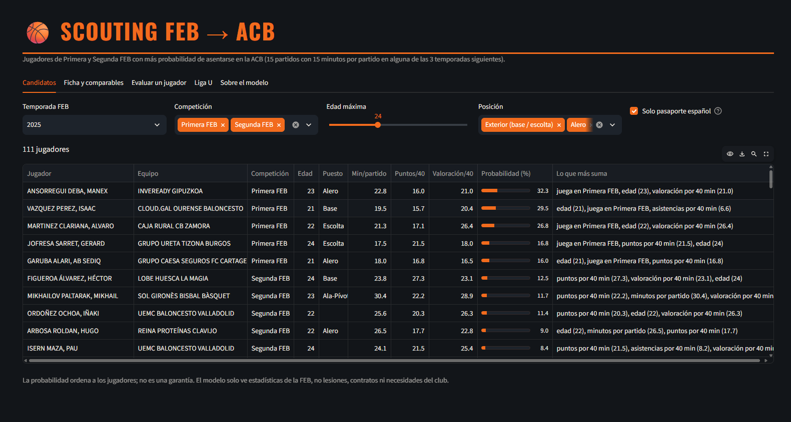
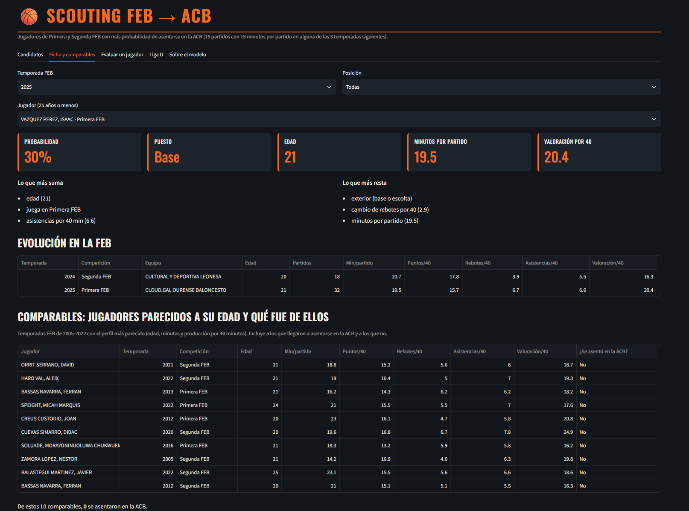
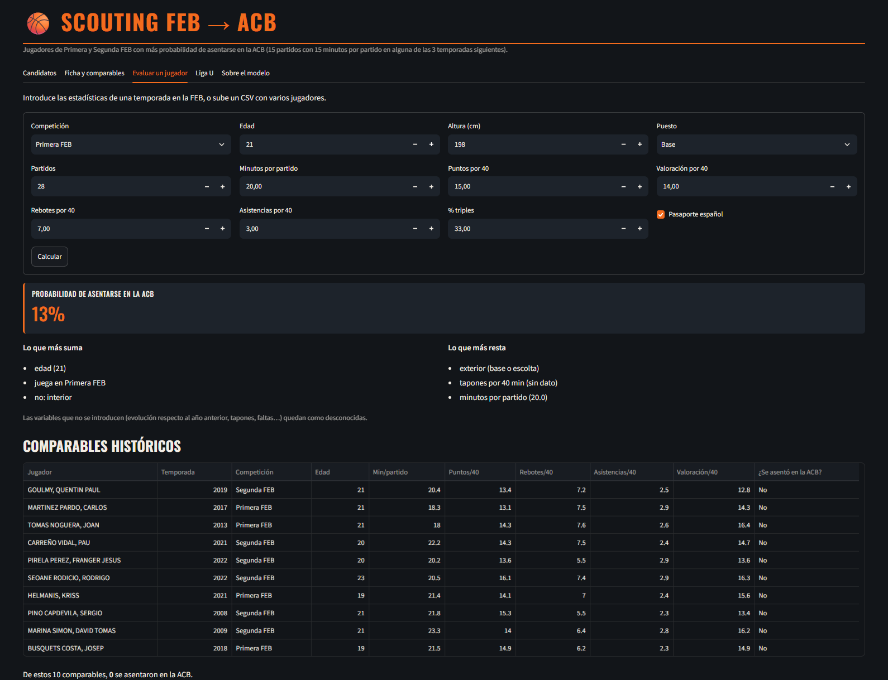

# Scouting FEB → ACB

Herramienta para que un club ACB de presupuesto medio, sin departamento de
datos, encuentre en Primera FEB y Segunda FEB a jugadores nacionales con
posibilidades reales de asentarse en la ACB.

**Aplicación:** [nationalscouting.streamlit.app](https://nationalscouting-juh2ruuenbunbpvfay5nun.streamlit.app/)

---

## 1. El problema y para quién

Los jugadores nacionales juegan cada vez menos minutos en la ACB (del 42 % en
2005 al 30 % en 2025), y los que pueden llegar a ser jugadores de rotación son
escasos. Los clubes grandes los forman en su cantera; un club de presupuesto
medio tiene que encontrarlos fuera. Casi todos pasan antes por las ligas FEB,
pero allí hay cientos de jugadores por temporada y un club medio no tiene
ojeadores para verlos a todos.

La aplicación ordena a los jugadores actuales de Primera y Segunda FEB según
su probabilidad de **asentarse en la ACB**, definida como jugar al menos 15
partidos con 15 minutos por partido en alguna de las tres temporadas
siguientes (un jugador de rotación). Cada recomendación lleva sus motivos y
una lista de jugadores históricos con un perfil parecido y lo que fue de ellos.

Lo que el usuario puede hacer y antes no podía: empezar el ojeo por una lista
corta ordenada con criterio, saber por qué está cada jugador en ella y
comprobar contra la historia si un perfil suele llegar o no.

## 2. Los datos

Recopilación propia por web scraping; no hay API pública con estos datos.

| Fuente | Qué aporta | Script |
|---|---|---|
| acb.com | Temporadas de cada jugador en la ACB desde 2005 (partidos, minutos, tiro, rebote…), licencia (JFL, EXT, EUR, COT…), nacionalidad, posición, altura y año de nacimiento | `src/scraping/acb.py` |
| baloncestoenvivo.feb.es (rankings) | Estadísticas por temporada de Primera FEB y Segunda FEB 2005-2025 y Liga U 2025/26 | `src/scraping/feb.py` |
| baloncestoenvivo.feb.es (fichas) | Año de nacimiento, altura, puesto, trayectoria en categorías FEB y totales de tiro por temporada | `src/scraping/feb_fichas.py`, `src/scraping/feb_totales.py` |

- **Fecha de obtención:** octubre de 2026.
- **Volumen:** 2.284 jugadores ACB (7.272 temporadas) y 3.114 jugadores FEB (8.136 temporadas).
- **Condiciones de uso:** robots.txt de acb.com permite el acceso; el aviso legal
  de la FEB prohíbe el uso comercial. Este es un proyecto académico, sin fines
  comerciales. El scraper hace una petición por segundo y se identifica con un
  correo de contacto (variable `CONTACTO_SCRAPER` en `.env`).
- **Datos personales:** solo nombre y año de nacimiento de jugadores
  profesionales con estadísticas públicas. No se guarda fecha ni lugar de
  nacimiento, ni cargos que no sean de jugador. La aplicación no muestra
  perfiles de menores de edad.
- **Sin identificador común** entre las dos webs: los jugadores se cruzan por año
  de nacimiento y nombre (`src/emparejar.py`), con 756 parejas. Los homónimos
  dudosos no se emparejan.

Todo el HTML descargado se guarda en caché (`data/raw/html_*`, fuera del
repositorio) para poder repetir la limpieza sin volver a descargar.

## 3. Preprocesamiento y EDA

Dos cuadernos: `notebooks/01_preproceso.ipynb` (limpieza, comprobaciones y
decisiones) y `notebooks/02_eda.ipynb` (14 preguntas sobre el caso de uso, cada
una con su gráfico o tabla y su conclusión).

Decisiones principales del preproceso:

- **acb.com publica medias por partido,** no totales: se reconstruyen los
  totales para sumar los clubes de una misma temporada y los porcentajes se
  ponderan por intentos.
- **Los rankings de la FEB no listan los ceros:** un jugador con minutos que no
  aparece en un ranking tiene 0 en esa estadística.
- **El tiro se completa con las fichas:** los rankings de porcentaje exigen un
  mínimo de intentos y dejaban sin dato de tiro al 27-65 % de las filas; con los
  totales de cada ficha baja al 0,5-1,2 %.
- **"Nacional" se define por la licencia, no por el pasaporte:** el 24 % de los
  JFL tiene pasaporte extranjero (canteranos de Senegal, Letonia, Montenegro…).
  ESP es la etiqueta antigua de JFL (todos los ESP se retiraron antes de
  2011-12). El filtro "Nacional" de la FEB mide el pasaporte y deja fuera a 85
  JFL: sirve como variable, no para identificar a los jugadores formados en España.
- **Mínimo de 100 minutos en la temporada FEB:** por debajo solo había 75 filas
  y 1 de los 306 jugadores que se asientan.
- **El cruce se revisó a mano:** 3 de 20 jugadores sin pareja eran fallos por
  el nombre de pila escrito distinto (Sergi/Sergio, Ion/Jon), lo que llevó a un
  tercer método de emparejamiento por nombre parecido.
- **Objetivo solo con el horizonte completo:** las temporadas 2023-2025 no tienen
  objetivo (no han pasado tres años) y son los candidatos a los que se aplica el
  modelo.
- **Datos de origen erróneos:** un año de nacimiento imposible en una ficha FEB
  (2019) se trata como desconocido.

Hallazgos principales del EDA:

- **El problema existe:** los jugadores nacionales (JFL o ESP) han pasado de
  jugar el 42 % de los minutos de la ACB en 2005 al 30 % en 2025. Siguen siendo
  el 39 % de las plantillas: están, pero juegan menos.
- **La FEB es la vía del talento nacional:** el 77 % de los nacionales que se
  asentaron en la ACB pasaron antes por Primera FEB, Segunda FEB o Liga U, frente
  al 11 % de los extranjeros. Muchos debutan jóvenes con minutos sueltos y se
  asientan después de una cesión en la FEB, por eso el objetivo es asentarse y
  no debutar.
- **Pocos casos y cada vez menos:** solo el 5 % de las temporadas FEB acaban en
  un jugador asentado, y en Primera FEB la proporción ha bajado del 12 % (2005-2010)
  al 7 % (2017-2022). Se usan métricas de ranking y validación por temporadas.
- **Qué distingue a los que se asientan:** son más jóvenes (17 % con 20 años o
  menos en Primera FEB, 2,5 % con 29 o más), juegan más minutos, producen más
  por 40 minutos y mejoran respecto al año anterior. Ninguna variable sola los
  separa: hace falta combinarlas en un modelo.
- **Primera y Segunda no son comparables:** los jugadores que suben de Segunda a
  Primera bajan de 16,6 a 12,8 de valoración por 40, así que la competición es
  una variable.
- **Por posición,** los aleros se asientan más (6,2 %) que los pívots (3,1 %).
  El puesto de la ficha FEB aparece escrito de 26 formas y se normaliza a cinco.
- **No hay talento nacional infravalorado:** con valoración alta, españoles y
  extranjeros se asientan igual; con valoración media, los españoles se asientan
  más, probablemente por el cupo. En la ACB juegan menos minutos que los
  extranjeros que llegaron con números parecidos. Elegir bien entre muchos
  candidatos nacionales de nivel medio es el problema que resuelve la aplicación.
- **La Liga U** es mucho más joven (mediana de 18 años) y solo tiene una
  temporada: no entra en el modelo y se muestra como ranking descriptivo.

## 4. Ciencia de datos

Cuaderno `notebooks/03_modelo.ipynb`; código común en `src/modelo.py`.

- **Problema:** clasificación binaria (se asienta / no se asienta) con 35
  variables, todas de la FEB: edad, nivel, minutos, producción por 40 minutos,
  tiro, posición y evolución respecto a la temporada anterior. Nada de la ACB
  entra como variable, para no filtrar información del resultado.
- **Validación por temporadas,** nunca aleatoria: entrenamiento 2005-2016,
  validación 2017-2018 (elección de modelo e hiperparámetros) y prueba
  2019-2022 (evaluación final).
- **Modelos comparados:** regresión logística, random forest, LightGBM (ajustado
  con Optuna) y una red neuronal (MLP), frente a dos líneas base sin modelo:
  ordenar por minutos y por valoración.
- **Métricas:** PR-AUC (adecuada con un 5 % de positivos; al azar vale lo mismo
  que la tasa de positivos), ROC-AUC y recall@20 (qué parte de los que se
  asientan está entre los 20 primeros de cada temporada).

| Prueba 2019-2022 | PR-AUC | ROC-AUC | recall@20 |
|---|---|---|---|
| **Regresión logística (elegida)** | **0,212** | 0,857 | 0,31 |
| Línea base: minutos | 0,117 | 0,716 | 0,24 |
| Línea base: valoración por 40 | 0,082 | 0,696 | 0,12 |
| Al azar | 0,033 | 0,500 | — |

- **Por qué la regresión logística:** es la mejor de los modelos explicables en
  validación. La red neuronal queda a su altura en validación y por debajo en
  prueba; con tan pocos positivos los modelos complejos no mejoran de forma
  consistente, y la logística da una explicación exacta de cada predicción.
- **Subgrupo con pasaporte español:** PR-AUC 0,214 frente a 0,088 de la línea
  base de minutos.
- **Lo que más pesa (SHAP):** jugar en Primera FEB, la edad, los puntos por 40
  minutos y los minutos por partido.
- **Limitaciones:** pocos positivos (58 en prueba), así que las métricas tienen
  bastante margen de error; el filtro nacional de la FEB mide el pasaporte; la
  Tercera FEB (EBA) no está incluida; la licencia ACB es la actual, no la de
  cada temporada; el modelo solo ve estadísticas, no lesiones, contratos ni
  necesidades del club. La probabilidad sirve para ordenar, no es una garantía.

## 5. La aplicación

`app/app.py`, hecha con Streamlit. Pestañas:

- **Candidatos:** ranking de los jugadores de 2023-2025 por probabilidad, con
  filtros de temporada, competición, edad, posición y pasaporte.
- **Ficha y comparables:** se elige temporada, posición y jugador; muestra
  probabilidad, motivos a favor y en contra, evolución en la FEB, los 10
  jugadores históricos con el perfil más parecido a su edad (indicando si
  llegaron a asentarse) y un gráfico de araña con sus percentiles frente a los
  jugadores de su misma posición y liga, que permite compararlo con otro jugador.
- **Evaluar un jugador:** formulario manual o subida de un CSV (con plantilla
  descargable) para jugadores que no están en la base; devuelve probabilidad,
  motivos, comparación con la media histórica y comparables.
- **Liga U:** ranking descriptivo (solo hay una temporada, sin desenlace aún).
- **Sobre el modelo:** métricas y limitaciones.







## 6. Instalación y ejecución

Requisitos: Python 3.11 o superior.

```bash
git clone https://github.com/c0sh1/national_scouting
cd national_scouting
python -m venv .venv
.venv\Scripts\activate
pip install -r requirements.txt
```

**Arrancar la aplicación** (los datos procesados, la base de datos y el modelo
están incluidos en el repositorio):

```bash
streamlit run app/app.py
```

**Comprobar el código:**

```bash
python -m pytest
```

**Repetir todo el proceso desde cero** (opcional; la descarga completa lleva
varias horas). Antes, crear un archivo `.env` en la raíz con la línea
`CONTACTO_SCRAPER=tu_correo@ejemplo.com`.

```bash
python -m src.scraping.acb
python -m src.scraping.feb --competicion primera_feb segunda_feb --temporadas 2005-2025
python -m src.scraping.feb --competicion liga_u --temporadas 2025
python -m src.scraping.feb_fichas
python -m src.scraping.feb_totales
python -m src.limpieza
python -m src.limpieza_feb
python -m src.emparejar
python -m src.dataset
python -m src.base_datos
```

Después, ejecutar `notebooks/02_eda.ipynb` y `notebooks/03_modelo.ipynb` de
arriba abajo; el 03 entrena el modelo y genera las predicciones de la aplicación.

## 7. Estructura del repositorio

```
app/app.py                 aplicación Streamlit
src/scraping/cliente.py    peticiones HTTP con pausa, reintentos y caché en disco
src/scraping/acb.py        extracción de acb.com
src/scraping/feb*.py       extracción de la FEB (rankings, fichas y totales)
src/limpieza.py            limpieza de la ACB
src/limpieza_feb.py        limpieza de la FEB
src/emparejar.py           cruce de jugadores FEB ↔ ACB
src/dataset.py             tabla del modelo y variable objetivo
src/base_datos.py          base de datos SQLite (data/scouting.db)
src/datos.py               lectura de datos para cuadernos y aplicación
src/modelo.py              variables, métricas y explicación del modelo
notebooks/                 01_preproceso, 02_eda, 03_modelo
tests/                     pruebas (pytest)
data/raw/                  datos tal como se extraen
data/processed/            datos limpios, informes de calidad y predicciones
models/modelo.joblib       modelo entrenado
docs/                      capturas
```

## 8. Qué mejoraría con más tiempo

- Incluir la Tercera FEB (EBA): algunos jugadores llegan a la ACB sin pasar por
  Primera ni Segunda FEB.
- Una aproximación a "formado en España" con la trayectoria FEB (temporadas en
  España antes de los 21 años), validada con la licencia ACB de los jugadores
  emparejados, para no depender del pasaporte.
- Volver a entrenar cada temporada: cuando terminen 2026/27 y siguientes, las
  predicciones actuales se podrán comprobar.
- Calibrar las probabilidades: la tasa de positivos ha bajado del 6 % en
  2005-2016 al 3 % en 2017-2022.
- Gráficos de tiro por zona, que necesitarían datos por lanzamiento que hoy no
  son públicos.